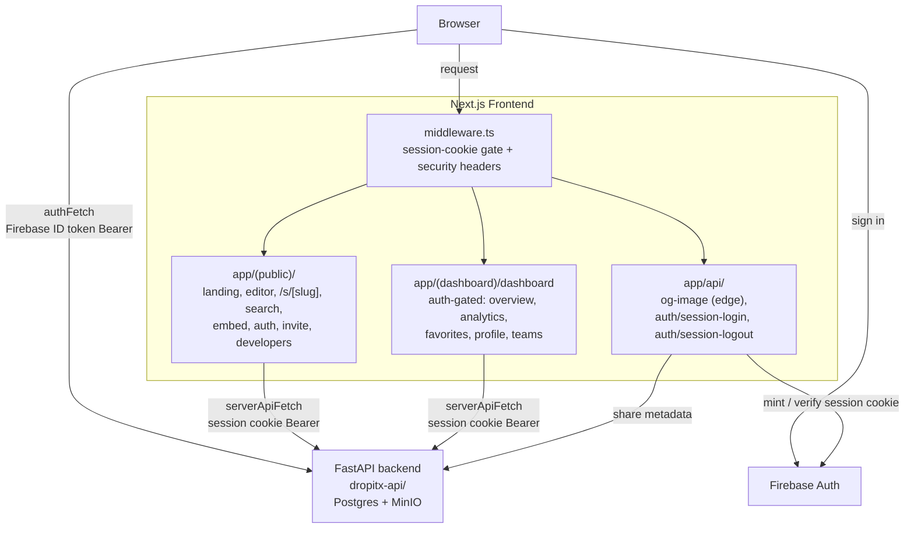

<!-- generated-by: gsd-doc-writer -->

# Architecture

> Canonical architecture reference for the **DropItX frontend** — the Next.js (App Router) client. Grounded in source; all paths cite real files.

## System Overview

DropItX is a file/text sharing product with team collaboration. This repository is the **pure frontend**: a Next.js 16 (App Router, React 19, TypeScript strict) application that owns no business logic and holds no database or storage credentials. It is one of three sibling repos:

- `dropitx/` (this repo) — Next.js frontend, shipped as a Docker image.
- `dropitx-api/` — FastAPI backend (shares, dashboard, teams, invites, analytics, API keys) on Postgres and MinIO, called via REST.
- `dropitx-cli/` — Python/Click CLI published to PyPI as `dropitx`; a separate client, not bundled here.

The frontend is a **thin client with one data backend**. Identity is Firebase Auth; every read and write goes to the **FastAPI backend**:

1. **Browser** — client components call it through `authFetch()` with a Firebase ID token as Bearer.
2. **Server components** — call it through `serverApiFetch()` (`lib/server-api.ts`), forwarding the visitor's `cf-connecting-ip` and, when a session exists, the httpOnly `session` cookie as the Bearer token.

The architectural style is **App Router with route groups**: server components by default, `"use client"` only for editor/interactive UI, and a middleware that gates `/dashboard/*` on the session cookie and injects security headers on every request.

## Component Diagram



The (public) and (dashboard) route groups are Next.js route groups (parenthesized names) — they organize routes and select layouts without adding URL segments. `app/api/` holds only the OG image route and the session login/logout routes; all business logic lives in the FastAPI backend.

## Data Flow

### 1. Every request — session gate and headers

`middleware.ts` runs on all routes except static assets and `api/og-image`. It:

1. Redirects `/dashboard/*` to `/auth/login?next=<path>` when the `session` cookie is absent. This is a presence check only; server components verify the cookie with `getSessionUser()` (`lib/firebase/server.ts`, `firebase-admin`).
2. Decorates the response with security headers (`x-content-type-options`, `x-frame-options: DENY`, `x-xss-protection`, `referrer-policy`, `permissions-policy`) and HSTS in production. `/embed/*` is the exception to `x-frame-options: DENY`: it sends `content-security-policy: frame-ancestors *` instead so third-party sites can frame it.

The `session` cookie is minted by `POST /api/auth/session-login` from a Firebase ID token (httpOnly, `SameSite=Lax`, 14 days) and cleared by `POST /api/auth/session-logout`.

### 2. Route dispatch and auth gating

- **`(public)/`** — unauthenticated surface. Renders the landing page (`app/(public)/page.tsx` → `components/home-page.tsx`), the CodeMirror editor (`app/(public)/editor/`), the share viewer (`app/(public)/s/[slug]/`), search, embed (`app/(public)/embed/[slug]/`), the developers page, the sign-in flows (`auth/login`, `auth/reset-password`, `auth/update-password`), and team invites (`invite/[token]`; `invite/accept?token=` redirects to it).
- **`(dashboard)/dashboard/`** — auth-gated surface. Its layout (`app/(dashboard)/dashboard/layout.tsx`) verifies the session with `getSessionUser()` and redirects to `/auth/login` when there is none, then loads the user's teams from the API for the sidebar. Sub-routes: overview, `analytics`, `analytics/[slug]`, `favorites`, `profile`, `teams`, `teams/new`, `teams/[slug]` (+ `members`, `settings`).

### 3. Viewing a share — `/s/[slug]`

`app/(public)/s/[slug]/page.tsx` is a server component that:

1. Reads share metadata with `getShareMeta()` (`lib/share-data.ts`, `GET /api/shares/{slug}`). This call never reads content, so it never counts a view or burns a share; `generateMetadata` and the OG image route use only this call.
2. Generates OpenGraph metadata; **private or password-protected shares get generic "Protected Document" OG tags** (no content leak), and the edge OG-image route (`app/api/og-image/[slug]/route.tsx`, `runtime = "edge"`) returns 404 for them.
3. Gates password-protected shares behind `PasswordGate` (client component). On submit it `POST`s to the API's `/api/shares/{slug}/unlock` and renders the returned content in place. There is no frontend access cookie; a refresh asks for the password again. Owners see their own protected content without the password.
4. Shows a "reveal" state for burn-after-reading and one-time shares (`RevealShareContent`); the client fetches `/content` only on an explicit click, because the API burns the share on the content read.
5. Renders other content through `getShareContent()` (`GET /api/shares/{slug}/content`, which counts the view). HTML goes through `components/html-viewer.tsx` inside a sandboxed iframe (`sandbox="allow-scripts"`); embeds (`app/(public)/embed/[slug]/`) use the same sandboxing.
6. Records the page view with `ShareAnalyticsTracker` (`POST /api/analytics/track`: slug, referrer, embed flag; the API derives visitor, country and referrer source). `lib/analytics.ts` exposes `trackEvent`, a no-op kept so call sites stay stable.

### 4. Calling the backend

**Client components** call `authFetch()` (`lib/api-client.ts`):

1. Reads the Firebase ID token from `auth.currentUser` and sets `Authorization: Bearer <token>` against `${NEXT_PUBLIC_API_URL}` (required; the module throws at load without it).
2. Sends the request with `Content-Type: application/json` unless the body is `FormData`.
3. **On `401`, force-refreshes the ID token once and retries.**

**Server components** call `serverApiFetch()` (`lib/server-api.ts`, `server-only`). It forwards `cf-connecting-ip`, sends the `session` cookie as the Bearer token when one exists (none otherwise), and throws `ApiError` on non-2xx. Typed readers live in `lib/share-data.ts` and `lib/dashboard-data.ts`; request/response types are generated from the API's OpenAPI spec into `lib/api-types.ts` (`npm run generate-types`).

## Key Abstractions

| Abstraction | File | Responsibility |
| --- | --- | --- |
| `authFetch`, `getAuthHeaders`, `getApiUrl` | `lib/api-client.ts` | Browser→FastAPI calls; injects the Firebase ID token as Bearer, single 401 refresh-retry. |
| `serverApiFetch`, `ApiError` | `lib/server-api.ts` | Server→FastAPI calls; forwards the client IP and session cookie bearer. |
| `getShareMeta`, `getShareContent` | `lib/share-data.ts` | Share metadata (no view counted) and content (counts a view). |
| `getSessionUser` | `lib/firebase/server.ts` | Verifies the Firebase session cookie with `firebase-admin`. |
| `unlockShare` | `lib/share-unlock.ts` | Password unlock against the API's `/unlock` endpoint. |
| `encrypt`/`decrypt`, `generateRandomKey`, `deriveKeyFromPassword` | `lib/crypto.ts` | AES-256-GCM helpers via Web Crypto (PBKDF2, 600k iterations, for password-derived keys). Currently used only by the hidden `components/encryption-toggle.tsx`; no page decrypts, so end-to-end encrypted publishing and viewing is not available in the web app (planned). |
| `hashPassword`/`verifyPassword` | `lib/password.ts` | bcryptjs password helpers. |
| `generateApiKey`/`hashApiKey` | `lib/api-key.ts` | API key generation and SHA-256 hashing (keys are never persisted in plaintext). |
| `createEditorExtensions`, `themeCompartment`, `updateTheme` | `lib/editor-extensions.ts` | CodeMirror 6 extension bundle (slash commands, image drop, theme switching). |
| Slash commands, image drop/preview | `lib/editor-extensions/slash-commands.ts`, `image-drop.ts`, `image-preview.ts` | CodeMirror plugins for `/image`, `/heading`, `/code` and inline drag-and-drop uploads. |
| `getHighlighter` | `lib/shiki-highlighter.ts` | Shiki singleton for GitHub-like code-block rendering. |
| `trackEvent`, `AnalyticsEvent` | `lib/analytics.ts` | Event-name constants and a no-op `trackEvent`; no analytics sink is wired up. |
| `fetchWithRateLimit`, `RateLimitError` | `lib/rate-limit.ts` | Client-side rate-limit handling with toast surfaced via `showRateLimitToast`. |
| Draft storage | `lib/draft-storage.ts` | localStorage auto-save for the editor (`saveDraft`/`loadDraft`/`hasDraft`). |

Shared domain types live in `types/` (`share.ts`, `team.ts`, `team-event.ts`, `analytics.ts`). Additional client hooks live in `hooks/` (`use-email-validation.ts`, `use-team.ts`, `use-toast.ts`) alongside the editor/auth hooks colocated in `lib/` (`use-auth-user.ts`, `use-auto-save.ts`, `use-editor-auto-save.ts`, `use-scroll-sync.ts`).

## Directory Structure Rationale

```
app/                         Next.js App Router — routes only, minimal logic
  (public)/                  Unauthenticated surface + its own layout
    page.tsx                 Landing (renders components/home-page.tsx)
    editor/page.tsx          CodeMirror editor (SSR disabled)
    s/[slug]/page.tsx        Public share viewer (sandboxed iframe)
    search/                  Full-text search
    embed/[slug]/            Embeddable share view (sandboxed iframe)
    developers/              Developer/API docs page
    auth/                    login, reset-password, update-password
    invite/[token]/          Team-invite page; invite/accept redirects to it
  (dashboard)/dashboard/     Auth-gated surface; middleware redirects anon → /auth/login
    page.tsx                 Overview (user's shares + upload)
    analytics/               Dashboard analytics and per-share analytics
    favorites/, profile/     Self-service account areas
    teams/                   new, [slug], [slug]/members, [slug]/settings
  api/                       Only three endpoints (rest is in FastAPI)
    og-image/[slug]/         Edge runtime OG-image generation (metadata only)
    auth/session-login       Mints the httpOnly session cookie from a Firebase ID token
    auth/session-logout      Revokes refresh tokens and clears the cookie
  layout.tsx                 Root layout: fonts, ThemeProvider, AuthProvider, ErrorBoundary, Toaster
  globals.css                Tailwind 4 + OKLCH design tokens
components/                  Feature components (kebab-case, <200 lines each)
  ui/                        shadcn/ui primitives (button, dialog, select, card, …)
  analytics/                 Sub-grouped analytics chart components
lib/                         Utilities + colocated client hooks
  firebase/                  Firebase client, auth helpers and server (session verification)
  editor-extensions/         CodeMirror plugins (slash-commands, image-drop, image-preview)
hooks/                       Additional client hooks
types/                       Shared TypeScript interfaces
public/                      Static assets (OG defaults, icons, etc.)
middleware.ts                Session-cookie gate for /dashboard + security headers
```

**Why this shape:**

- **Route groups (`(public)` / `(dashboard)`)** let each surface pick its own layout and auth posture without polluting the URL. `/dashboard/*` is gated twice: middleware redirects when the session cookie is absent, and the dashboard layout verifies it with `getSessionUser()`.
- **One data path.** Browser code uses `authFetch`, server code uses `serverApiFetch`; the API owns authorization, so the frontend carries no database keys. Server code never imports `lib/api-client.ts` (it loads the Firebase client SDK).
- **`app/api/` is intentionally tiny** (OG images + session cookie routes) because business logic migrated to the FastAPI backend; the frontend's API routes only do what must run on the same origin.
- **`components/ui/` (shadcn/ui) vs `components/*`** separates owned primitives from product-specific components; the latter are kept under 200 lines and prefer composition over nesting.
- **`lib/` holds both utilities and some hooks**, colocating editor/auth hooks with the code they drive; `hooks/` holds the remaining general-purpose client hooks.

## Notes

- **No test framework is configured.** Correctness is verified via `npm run check:hygiene` and `npm run build` (TypeScript strict, no `any` — use `unknown` and narrow).
- **Editor SSR is disabled.** CodeMirror depends on browser APIs and is loaded via dynamic import with `ssr: false`.
- **`next.config.ts` sets only `output: "standalone"`** for the Docker image; all runtime behavior comes from environment variables and middleware.
